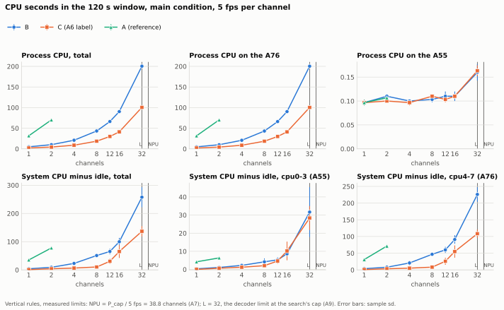
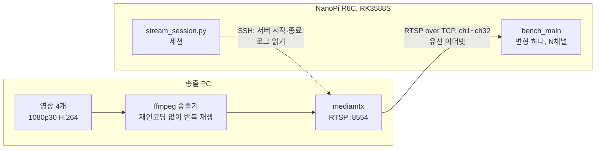
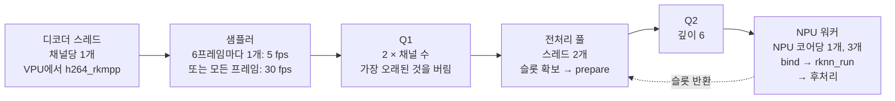
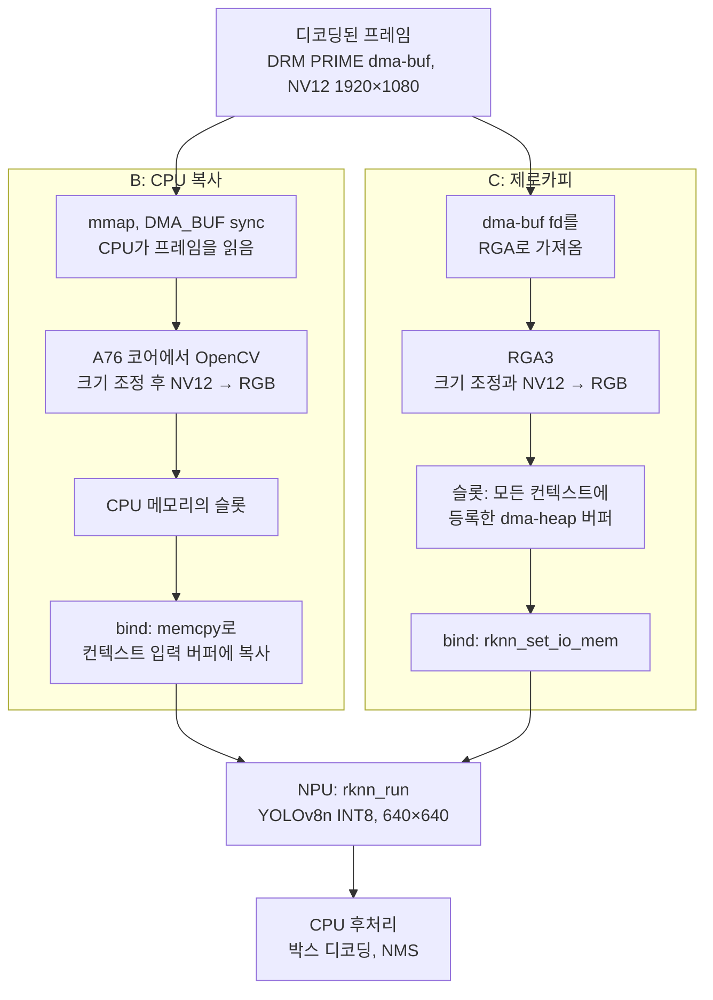

[English](README.md)

# rk3588s-zero-copy

RK3588S에서 제로카피 영상 파이프라인은 실제로 얼마나 절약하며, 어떤 조건에서 그런가? 이 저장소는 NanoPi R6C에서 수행하는 사전 등록 실험으로 이 질문에 답한다. 코드는 실험을 재현할 수 있도록 여기에 둔다.

이 프로젝트가 공개하는 것:
- 사전 등록한 가설마다 판정과 그 근거가 된 측정을 담은 리포트: [docs/report/M1.ko.md](docs/report/M1.ko.md)
- 다채널 검출 데모
- 결과를 다시 만드는 스크립트

라이브러리가 아니라 실험이다. 제로카피가 아무것도 절약하지 못한다는 결과도 유효한 답이다.

## 비교 대상

두 파이프라인은 RTSP 입력, 디코더(ffmpeg-rockchip `h264_rkmpp`, DRM PRIME 프레임), 모델(YOLOv8n INT8), 파이프라인 구조가 같다. 디코딩된 프레임에서 NPU 입력까지의 경로만 다르다.

| 변형 | 디코딩된 프레임 → NPU 입력 |
|---|---|
| **B** CPU 복사 | 프레임을 `mmap`하고, OpenCV로 전처리한 뒤, 바인딩된 NPU 입력 버퍼에 `memcpy`로 복사한다([AMENDMENTS A3](prereg/AMENDMENTS.ko.md)) |
| **C** 제로카피 | dma-buf fd → RGA → `rknn_create_mem_from_fd`로 등록한 dma-heap 버퍼 |
| A (참조) | 소프트웨어 디코딩 + B 경로, 1–2채널만 |
| none | 디코딩만 한다. 디코더가 몇 채널까지 감당하는지 찾는 데 쓴다 |

## M1 결과

`freeze-m1` 뒤 2026-11-03에 134회를 실행했고, 모두 유효했다. 전체 보고서는 [docs/report/M1.ko.md](docs/report/M1.ko.md)에 있다.

| 가설 | 사양 판정 | 실질 판정 | 수치 |
|---|---|---|---|
| H1, 8채널(채널당 5 fps)의 프로세스 CPU | 채택 | 채택 | 120초당 B 43.3초, C 18.6초: 57.1% 적음 |
| H2, 5채널(채널당 30 fps)의 p99 지연 | 기각 | 기각 | B 24.5 ms, C 25.9 ms |
| H3, 채널당 5 fps를 유지하는 최대 채널 수 | 채택 | 판정 불가(상한 도달) | B 32, C 32, 상한 |

- **CPU:** C는 모든 채널 수에서 프로세스 CPU를 절반가량 줄인다. 5 fps에서 50–58%, 30 fps에서 72–73%다.
- **지연:** C의 중앙값 지연은 16채널까지 낮다. NPU가 바빠지면, 즉 30 fps 5채널과 32채널에서는 p99가 낮지 않다.
- **채널:** 두 변형 모두 A76 코어 네 개 안에서 상한인 32채널까지 모든 채널 수를 유지했다.
- **조건:** 파이프라인이 A76 코어에서 돌고 디코더 버퍼가 CPU 캐시를 쓸 때의 결과다. 모든 C 결과에는 A6의 표시가 붙는다. NPU 런타임은 여전히 자체적으로 작은 복사를 한다.



## 지금까지의 발견

B/C 비교 실행 전에, 두 파이프라인을 만들고 캘리브레이션하면서 알아낸 것들이다.

- **`rknn_inputs_set`은 바인딩된 출력과 함께 쓸 수 없다**(librknnrt 2.3.2). 컨텍스트의 입력을 `rknn_inputs_set`으로 넣으면 `rknn_set_io_mem`으로 바인딩한 출력이 전혀 기록되지 않고 0으로 남는다. 그래서 B는 바인딩된 입력 버퍼에 `memcpy`로 입력을 복사한다. ([A3](prereg/AMENDMENTS.ko.md))
- **1/3 축소에서 RGA3의 축소기는 OpenCV와 한 픽셀 어긋난 고정 3×3 박스다.** 1920×1080 → 640×360에서 출력 픽셀 하나는 OpenCV `INTER_AREA`의 블록보다 한 픽셀 뒤에서 시작하는 3×3 입력 블록의 평균이고, RGA의 보간 설정은 효과가 없다. B를 여기에 맞춰 `INTER_AREA`의 휘도 박스를 한 픽셀 옮기자, B와 C 텐서의 평균 절대 차이가 2.41로 줄었다(0–255 기준). `INTER_LINEAR`로는 4.50, 그냥 `INTER_AREA`로는 3.78이었다. ([A4](prereg/AMENDMENTS.ko.md))
- **동등성에는 다른 잣대가 필요했다.** 이 작은 텐서 차이만으로 INT8 모델의 신뢰도가 최대 0.26 움직인다. 등록한 기준은 픽셀이 완전히 같은 입력만 통과할 수 있었고, B와 C는 통과하지 못했다. 수정한 기준은 C와 B의 차이가 B의 허용 가능한 두 OpenCV 변형 사이의 차이보다 크지 않고, 전체 박스 수가 2% 안에서 일치할 것을 요구한다. B와 C는 이를 통과한다. 이 기준은 데이터를 본 뒤에 정했다. 그래서 기준을 정할 때 쓰지 않은 영상 3개로 하는 검사를 실행 전에 등록했고([A8](prereg/AMENDMENTS.ko.md)), B와 C는 2,414프레임 전체로도, 영상별로도 이 검사를 통과한다. ([A5](prereg/AMENDMENTS.ko.md), [동등성](docs/notes/equivalence.ko.md))
- **"제로카피"도 NPU 런타임 안에서는 복사한다.** C의 코드는 픽셀 데이터를 복사하지 않지만, `rknn_run` 한 번마다 작은 복사가 약 1,150번(각 512바이트 이하, 모두 합쳐 약 15 KB) 일어나며 B도 같다. 프로파일 샘플로 세면 이것만으로 등록한 제로카피 perf 기준을 넘는다. strace 검사(C에서 dma-buf `mmap` 없음)는 통과한다. 런타임이 추론 1회당 약 1.2 MB인 출력을 CPU로 변환하는지는 아직 밝히지 못했다. ([A6](prereg/AMENDMENTS.ko.md))
- **A76의 최고 클럭이 부팅마다 바뀐다.** cpu4–5의 최고 주파수가 어떤 부팅에서는 2304 MHz, 다른 부팅에서는 2352 MHz였다. 그래서 두 A76 클러스터를, 확인한 모든 부팅에서 제공된 2208 MHz로 고정했다. ([A7](prereg/AMENDMENTS.ko.md))
- **NPU 코어 3개는 코어 1개의 2.8배다.** 코어를 늘릴수록 `rknn_run`이 14.1 ms에서 15.0 ms로 느려져, 메모리 대역폭 같은 공유 자원이 병목임을 시사한다. 후처리를 포함한 NPU 단계는 초당 194.2회 추론이 최대이며, 이것이 파이프라인 전체의 상한이다. ([캘리브레이션](docs/notes/calibration.ko.md))

## 구조

### 측정 구성



스트림은 별도 PC가 송출한다. 그래서 송출 부담이 보드에 걸리지 않는다. 채널 `chN`은 영상 4개 중 하나를 반복 재생하고([stream-server/assignment_m1.txt](stream-server/assignment_m1.txt)), 보드가 접속할 때 송출을 시작한다. 그래서 실행마다 각 영상이 처음부터 재생된다. 서버 로그는 모든 실행의 유효성 검사 항목 중 하나다(PROTOCOL §9.3).

### 파이프라인

모든 변형이 같은 단계를 거친다(PROTOCOL §5.1). A만 VPU 대신 소프트웨어로 디코딩한다.



- 입력 슬롯 11개를 전처리 풀과 NPU 워커가 함께 쓴다. 프레임을 버리는 큐는 Q1뿐이다.
- NPU 워커는 각각 NPU 코어 하나에 고정된 RKNN 컨텍스트를 하나씩 가진다. Q2에서 아무 슬롯이나 받아 자기 컨텍스트에 바인딩한다.
- 파이프라인과 라이브러리가 만드는 모든 스레드는 A76 코어 4개(cpu4–7)에서 돈다. cpu0의 스레드가 NPU 부하, 온도, 클럭, 프로세스 메모리, 채널별 디코딩 프레임 수를 1초마다 기록한다.
- CPU, DDR, NPU 클럭은 고정한다([AMENDMENTS A7](prereg/AMENDMENTS.ko.md)). 클럭이 고정값 아래로 내려간 실행은 무효다.

### B와 C

`prepare`, `bind`, 입력 슬롯의 메모리만 다르다(PROTOCOL §5.2).



둘 다 640×640 슬롯 가운데에 640×360 이미지를 쓴다. 슬롯 테두리는 시작할 때 한 번 채운다. C에서는 스트리밍 중에 CPU가 픽셀 데이터를 읽거나 쓰지 않는다. perf 프로파일로 이를 확인하며(PROTOCOL §11.4), 확인한 결과는 [AMENDMENTS A6](prereg/AMENDMENTS.ko.md)에 있다.

## 스택

| 계층 | 사용한 것 | 비고 |
|---|---|---|
| 보드 | FriendlyElec NanoPi R6C: RK3588S, Cortex-A76 4개와 Cortex-A55 4개, 3코어 NPU, 8 GB | 방열판과 팬. 냉각 구성은 M1-3 열 확인으로 확정한다 |
| OS | FriendlyElec Ubuntu 24.04, 커널 6.1 | RKNPU 드라이버 0.9.8 |
| 디코딩 | [ffmpeg-rockchip](https://github.com/nyanmisaka/ffmpeg-rockchip) 커밋 `8b4385e9`, Rockchip MPP 위의 `h264_rkmpp` | DRM PRIME 프레임. A는 ffmpeg의 소프트웨어 H.264 디코더를 쓴다. |
| C의 전처리 | librga 1.10.3, im2d API, RGA3 코어 2개 | |
| B와 A의 전처리 | OpenCV 4.6.0(Ubuntu 패키지), 단일 스레드 | [AMENDMENTS A2](prereg/AMENDMENTS.ko.md) |
| 추론 | RKNN 런타임(librknnrt) 2.3.2, C API | 컨텍스트 3개, NPU 코어당 1개 |
| 모델 | rknn_model_zoo v2.3.2의 YOLOv8n, rknn-toolkit2 2.3.2로 INT8 변환 | [models/README.ko.md](models/README.ko.md) |
| 코드 | C++17, CMake, gcc 13.3 | |
| 스트림 | 별도 Linux PC의 mediamtx v1.21.2와 ffmpeg | [stream-server/README.ko.md](stream-server/README.ko.md) |
| 스크립트 | POSIX 셸, Python 3(표준 라이브러리만. `tools/equivalence_check.py`와 `tools/m1_report.py`는 numpy, `tools/m1_plots.py`는 matplotlib도 씀) | 세션, 분석, 검사 |

정확한 버전과 하드웨어 블록은 [docs/notes/env.ko.md](docs/notes/env.ko.md)에 있다.

## 사전 등록

가설, 판정 규칙, 측정 프로토콜은 어떤 측정보다 먼저 등록했다.

- [prereg/HYPOTHESES.ko.md](prereg/HYPOTHESES.ko.md): H1 (8채널에서의 CPU), H2 (5채널에서의 p99 지연), H3 (최대 채널 수)
- [prereg/PROTOCOL.ko.md](prereg/PROTOCOL.ko.md): 조건, 지표, 유효성 규칙, 동등성 기준
- [prereg/AMENDMENTS.ko.md](prereg/AMENDMENTS.ko.md): 이후 변경의 추가 전용 기록

등록은 두 단계다. `prereg-v1`은 가설과 프로토콜을 고정한다. `freeze-m1`은 B/C 비교 실행 전에 구현 설정을 고정한다. 각 단계의 기준 시각은 커밋 날짜가 아니라 해당 GitHub Release의 `created_at`이다.

## 마일스톤

| 마일스톤 | 내용 | 릴리스 |
|---|---|---|
| M1 | B 대 C 파이프라인, 채널 스윕 리포트, 다채널 검출 데모 | `v0.1-m1` |
| M1.1 (선택) | 민감도 및 탐색 실행 | `v0.1.1` |
| M2 | 후처리 최적화, 동일 모델 | `v0.2-m2` |
| M3 | 명령 하나로 재현하는 스크립트 | `v0.3-m3` |
| M4 | 부록: NMS 없는 모델, mAP와 처리량 | `v0.4-m4` |

**현재 상태:** M1-6 비교 실행을 마쳤고, M1-7 보고서는 [docs/report/M1.ko.md](docs/report/M1.ko.md)에 있다. 그에 앞서 동결 [`freeze-m1`](https://github.com/eunkyo3/rk3588s-zero-copy/releases/tag/freeze-m1)(기준 시각 2026-11-03T06:58:17Z), M1-3 캘리브레이션([docs/notes/calibration.ko.md](docs/notes/calibration.ko.md)), M1-4 동등성([docs/notes/equivalence.ko.md](docs/notes/equivalence.ko.md))을 마쳤다. M1.1의 작은 4K 탐색 설계([AMENDMENTS A11](prereg/AMENDMENTS.ko.md))는 그 뒤에 돈다.

비교 결과는 `v0.1-m1` 리포트와 함께 공개한다.

## 빌드와 실행

보드에서 한다. MPP, librga, librknnrt는 FriendlyElec 이미지에 들어 있다.

```sh
sudo apt-get update && sudo apt-get install cmake libopencv-dev
tools/setup/build_ffmpeg_rockchip.sh   # build-essential, pkg-config, libdrm-dev 설치 후 ffmpeg-rockchip을 /opt/ffmpeg-rockchip에 설치
tools/setup/fetch_rknn_headers.sh      # RKNN C API 헤더를 /opt/rknpu2/include에 설치
cmake -S . -B build -DCMAKE_BUILD_TYPE=Release -DCODE_COMMIT=$(git rev-parse HEAD) # git 클론에서
cmake --build build -j4
```

다른 컴퓨터에서는 `tools/deploy_board.sh [user@host]`가 작업 트리를 보드에 복사하고 보드에서 빌드한다. 모든 결과 헤더에는 CMake에 `CODE_COMMIT`으로 넘긴 커밋이 들어간다(없으면 `unknown`). `deploy_board.sh`는 이 값을 넣고, 복사한 트리가 커밋과 다르면 `-dirty`를 붙인다.

그다음:
1. 모델을 `models/`에 내려받는다([models/README.ko.md](models/README.ko.md)).
2. PC에서 송출 서버를 시작한다([stream-server/README.ko.md](stream-server/README.ko.md)).
3. 변형 하나를 N채널로 root 권한으로 실행한다(NPU 부하를 debugfs에서 읽기 때문이다).

```sh
sudo build/bench_main --variant C --channels 8 --source 'rtsp://<pc>:8554/ch{n}'
```

`{n}`은 채널 번호로 바뀐다. 실행은 20초 예열한 뒤 120초 측정한다. `summary.csv`, `channels.csv`, `frames.csv`, `samples.csv`, `threads.csv`, `env.json`을 `results/check/<UTC 시각>_C_8ch/`에 쓴다. 옵션은 [src/app/bench_main.cpp](src/app/bench_main.cpp) 맨 위에 있다.

판정에 쓰는 실행은 PROTOCOL §9의 순서, 냉각 대기, 유효성 규칙도 따른다. `tools/calib_npu.sh`가 `P_cap` 캘리브레이션에, `tools/stream_session.py`가 RTSP 세션에 이를 적용한다([docs/notes/comparison.ko.md](docs/notes/comparison.ko.md)). 보고서의 파일은 [docs/report/M1.ko.md](docs/report/M1.ko.md)의 명령으로 다시 만든다. 실행을 명령 하나로 재현하는 스크립트는 M3에서 나온다.

테스트: 파이프라인 코어는 `build/test_core`, Python 도구는 `python3 tests/test_calib_summary.py`, `tests/test_check_prereg_order.py`, `tests/test_equivalence_check.py`, `tests/test_stream_session.py`, `tests/test_m1_report.py`, `tests/test_m1_plots.py`, `tests/test_m1_stages.py`(동등성과 리포트 테스트는 numpy, 그림 테스트는 matplotlib 필요).

## 저장소 구조

| 경로 | 내용 |
|---|---|
| `prereg/` | 가설, 프로토콜, 수정 기록. 영어판이 기준이고 `*.ko.md`는 번역이다. |
| `src/core/` | 공통 파이프라인: 입력, 큐, 슬롯, NPU 컨텍스트, 후처리, 지표, 결과 기록 |
| `src/preprocess/` | 변형별 부분: B(`cpu_copy`), C(`zero_copy_rga`), A(`cpu_sw`) |
| `src/app/bench_main.cpp` | 벤치마크 실행 파일: 변형 하나를 채널 수 하나로 한 번 실행 |
| `tools/` | 클럭 고정, 캘리브레이션, 동등성, 제로카피 근거 도구, 진단 도구, 사전 등록 순서 검사, 보드 준비, 모델 변환, 배포, 환경 기록 |
| `stream-server/` | mediamtx 설정, 영상 준비, 주어진 채널 배정을 검사하는 송출 스크립트 |
| `models/` | 모델 다운로드와 변환. 파일은 Release에 있다. |
| `tests/` | 파이프라인 코어와 Python 도구의 테스트 |
| `docs/notes/` | 마일스톤별 기록: 환경, 스파이크, 전처리, 코어, 동등성, 캘리브레이션, 비교, 분석 |
| `docs/report/` | M1 보고서와 그 표, 요약 파일, 그림 |
| `results/` | 모든 실행의 원자료. 큰 텐서 덤프는 Release에 둔다. 파일마다 헤더에 코드, 모델, 수정 기록 번호가 있다(PROTOCOL §1). |

## 라이선스

이 저장소는 [Apache License 2.0](LICENSE)을 따른다.

- `src/core/yolov8_post.cpp`의 박스 디코딩은 rknn_model_zoo v2.3.2(Apache-2.0, Rockchip)를 따랐다.
- 모델 파일은 이 저장소에 없다. Ultralytics YOLOv8에서 파생됐으므로 AGPL-3.0으로 배포하며, 라이선스 전문은 해당 Release에 있다([models/README.ko.md](models/README.ko.md)).
- 벤치마크 영상도 이 저장소에 없다. 출처와 라이선스는 [docs/notes/preprocess.ko.md](docs/notes/preprocess.ko.md#벤치마크-영상)에 있다.
