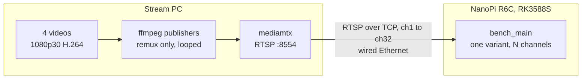
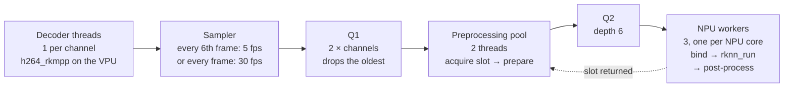
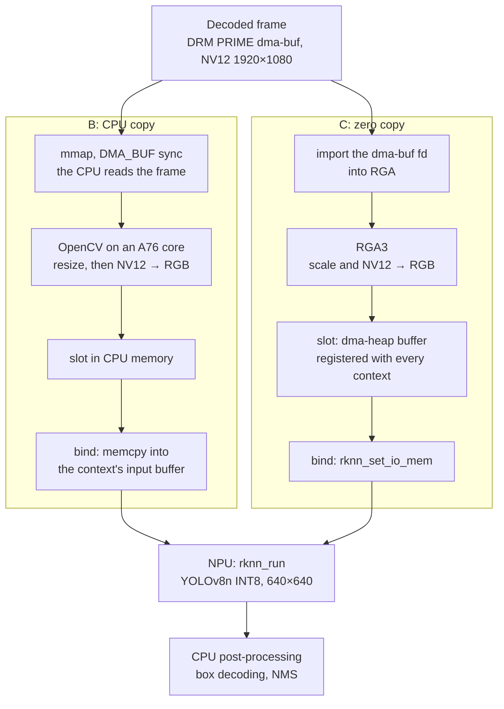

[한국어](README.ko.md)

# rk3588s-zero-copy

How much does a zero-copy video pipeline actually save on an RK3588S, and under which conditions? This repository answers that with a pre-registered experiment on a NanoPi R6C. The code is here to make the experiment reproducible.

The project will publish:
- a report that gives each pre-registered hypothesis its verdicts, with the measurements behind them;
- a multi-channel detection demo;
- scripts that reproduce the results.

It is an experiment, not a library. A result in which zero copy saves nothing is a valid answer.

## The comparison

Two pipelines share the same RTSP input, decoder (ffmpeg-rockchip `h264_rkmpp`, DRM PRIME frames), model (YOLOv8n INT8) and pipeline structure. Only the path from the decoded frame to the NPU input differs.

| Variant | Decoded frame → NPU input |
|---|---|
| **B** CPU copy | `mmap` the frame, preprocess with OpenCV, copy with `memcpy` into a bound NPU input buffer ([AMENDMENTS A3](prereg/AMENDMENTS.md)) |
| **C** zero copy | dma-buf fd → RGA → dma-heap buffer registered with `rknn_create_mem_from_fd` |
| A (reference) | software decoding + the B path, 1–2 channels only |
| none | decoding only, to find how many channels the decoder sustains |

## Findings so far

Building and calibrating the two pipelines, before any B/C comparison run, turned up these:

- **`rknn_inputs_set` does not mix with bound outputs** (librknnrt 2.3.2). When a context's input comes from `rknn_inputs_set`, the outputs bound with `rknn_set_io_mem` are never written; they stayed zero. So B copies its input with `memcpy` into a bound input buffer instead. ([A3](prereg/AMENDMENTS.md))
- **At 1/3 scale, RGA3's scaler is a fixed 3×3 box, one pixel off OpenCV's.** At 1920×1080 → 640×360, each output pixel is the mean of a 3×3 input block that starts one pixel later than OpenCV's `INTER_AREA` block, and RGA's interpolation setting has no effect. Matching B to it, with the luma box of `INTER_AREA` moved by one pixel, cut the mean absolute difference between B's and C's tensors to 2.41 (on 0–255), from 4.50 with `INTER_LINEAR` and 3.78 with plain `INTER_AREA`. ([A4](prereg/AMENDMENTS.md))
- **Equivalence needed a different yardstick.** Those small tensor differences move the INT8 model's confidences by up to 0.26. The registered criteria could only be met by pixel-identical inputs, and B and C failed them. Under the amended criteria, C may differ from B no more than B's two admissible OpenCV variants differ from each other, and the total box count must agree within 2%; B and C pass. These criteria were chosen after seeing the data. So a check on three videos not used to choose them was registered before it ran ([A8](prereg/AMENDMENTS.md)), and B and C pass it too, on all 2,414 frames together and on each video. ([A5](prereg/AMENDMENTS.md), [equivalence](docs/notes/equivalence.md))
- **"Zero copy" still copies inside the NPU runtime.** C's own code copies no pixel data, but each `rknn_run` makes about 1,150 small copies (none over 512 bytes, about 15 KB in all), in B as in C. Counted as profile samples, they exceed the registered perf threshold for zero copy; the strace check (no dma-buf `mmap` in C) passes. Whether the runtime converts the outputs, about 1.2 MB per inference, on the CPU is still open. ([A6](prereg/AMENDMENTS.md))
- **The A76 top clock changes between boots.** The highest frequency of cpu4–5 was 2304 MHz on some boots and 2352 MHz on others. Both A76 clusters are fixed at 2208 MHz, which every boot seen offers. ([A7](prereg/AMENDMENTS.md))
- **Three NPU cores give 2.8 times one core.** `rknn_run` slows from 14.1 to 15.0 ms as cores are added, which points to a shared resource such as memory bandwidth. With post-processing, the NPU stage tops out at 194.2 inferences/s, an upper bound for the whole pipeline. ([calibration](docs/notes/calibration.md))

## Architecture

### Test setup



A separate PC serves the streams, so that serving them costs the board nothing. Channel `chN` loops one of four videos, and its publisher starts when the board connects, so every run starts each video from the beginning. The server's log is one of the validity checks of every run (PROTOCOL §9.3).

### Pipeline

All variants run the same stages (PROTOCOL §5.1). Only A decodes in software instead of on the VPU.



- 11 input slots are shared by the preprocessing pool and the NPU workers. Q1 is the only queue that drops.
- Each NPU worker owns one RKNN context on one NPU core. It takes any slot from Q2 and binds it to its own context.
- The pipeline, and every thread the libraries start, run on the four A76 cores (cpu4–7). A thread on cpu0 samples every second the NPU load, temperatures, clocks, the process's memory and each channel's count of decoded frames.
- CPU, DDR and NPU clocks are fixed ([AMENDMENTS A7](prereg/AMENDMENTS.md)). A run in which a clock falls below its fixed value is invalid.

### B and C

Only `prepare`, `bind` and the memory behind the input slots differ (PROTOCOL §5.2):



Both write the 640×360 image into the middle of a 640×640 slot whose border was filled once at start. In C the CPU does not read or write pixel data while streaming. perf profiles check this (PROTOCOL §11.4); what they found is in [AMENDMENTS A6](prereg/AMENDMENTS.md).

## Stack

| Layer | Used | Note |
|---|---|---|
| Board | FriendlyElec NanoPi R6C: RK3588S, 4 Cortex-A76 and 4 Cortex-A55 cores, 3-core NPU, 8 GB | heatsink and fan; the M1-3 thermal check fixes the cooling |
| OS | FriendlyElec Ubuntu 24.04, kernel 6.1 | RKNPU driver 0.9.8 |
| Decoding | [ffmpeg-rockchip](https://github.com/nyanmisaka/ffmpeg-rockchip) commit `8b4385e9`, `h264_rkmpp` over Rockchip MPP | DRM PRIME frames. A uses ffmpeg's software H.264 decoder. |
| C's preprocessing | librga 1.10.3, im2d API, on the two RGA3 cores | |
| B's and A's preprocessing | OpenCV 4.6.0 (Ubuntu packages), single-threaded | [AMENDMENTS A2](prereg/AMENDMENTS.md) |
| Inference | RKNN runtime (librknnrt) 2.3.2, C API | three contexts, one per NPU core |
| Model | YOLOv8n from rknn_model_zoo v2.3.2, INT8 with rknn-toolkit2 2.3.2 | [models/README.md](models/README.md) |
| Code | C++17, CMake, gcc 13.3 | |
| Streams | mediamtx v1.21.2 and ffmpeg on a separate Linux PC | [stream-server/README.md](stream-server/README.md) |
| Scripts | POSIX shell; Python 3, standard library only, plus numpy for `tools/equivalence_check.py` | sessions, analysis, checks |

Exact versions and the hardware blocks: [docs/notes/env.md](docs/notes/env.md).

## Pre-registration

The hypotheses, verdict rules and measurement protocol were registered before any measurement:

- [prereg/HYPOTHESES.md](prereg/HYPOTHESES.md): H1 (CPU at 8 channels), H2 (p99 latency at 5 channels), H3 (maximum channel count)
- [prereg/PROTOCOL.md](prereg/PROTOCOL.md): conditions, metrics, validity rules, equivalence criteria
- [prereg/AMENDMENTS.md](prereg/AMENDMENTS.md): append-only record of later changes

Registration has two stages. `prereg-v1` fixes the hypotheses and protocol. `freeze-m1` fixes the implementation settings before any B/C comparison run. The reference time of each stage is the `created_at` of its GitHub Release, not the commit date.

## Milestones

| Milestone | Content | Release |
|---|---|---|
| M1 | B vs C pipelines, channel sweep report, multi-channel detection demo | `v0.1-m1` |
| M1.1 (optional) | sensitivity and exploratory runs | `v0.1.1` |
| M2 | post-processing optimization, same model | `v0.2-m2` |
| M3 | one-command reproduction scripts | `v0.3-m3` |
| M4 | appendix: NMS-free model, mAP and throughput | `v0.4-m4` |

**Current status:** M1-3, calibration. The fixed clocks, `P_cap` (194.2 inferences/s) and the H2 auxiliary point (5 channels) are fixed ([AMENDMENTS A7](prereg/AMENDMENTS.md), [docs/notes/calibration.md](docs/notes/calibration.md)). The wired stream server is set up ([docs/notes/env.md](docs/notes/env.md#network)). Next: the decode-only limit `L`, the loop check of §3 and the thermal check. Done before: M1-4, equivalence: B and C are equivalent under the criteria in force ([AMENDMENTS A5](prereg/AMENDMENTS.md)), and not under the registered criteria ([docs/notes/equivalence.md](docs/notes/equivalence.md)). C's input path makes no CPU pixel copy, but small copies inside the NPU runtime, the same in B, exceed the §11.4 perf threshold ([AMENDMENTS A6](prereg/AMENDMENTS.md)).

The comparison results come with the report of `v0.1-m1`.

## Build and run

On the board. The FriendlyElec image provides MPP, librga and librknnrt.

```sh
sudo apt-get update && sudo apt-get install cmake libopencv-dev
tools/setup/build_ffmpeg_rockchip.sh   # build-essential, pkg-config, libdrm-dev, then ffmpeg-rockchip into /opt/ffmpeg-rockchip
tools/setup/fetch_rknn_headers.sh      # RKNN C API headers into /opt/rknpu2/include
cmake -S . -B build -DCMAKE_BUILD_TYPE=Release -DCODE_COMMIT=$(git rev-parse HEAD) # in a git clone
cmake --build build -j4
```

From another machine, `tools/deploy_board.sh [user@host]` copies the working tree to the board and builds it there. Every result header carries the commit given to CMake as `CODE_COMMIT` (`unknown` without it). `deploy_board.sh` sets it, with `-dirty` when the copied tree differs from the commit.

Then:
1. Download the model into `models/` ([models/README.md](models/README.md)).
2. Start the stream server on the PC ([stream-server/README.md](stream-server/README.md)).
3. Run one variant on N channels, as root (the NPU load is read from debugfs):

```sh
sudo build/bench_main --variant C --channels 8 --source 'rtsp://<pc>:8554/ch{n}'
```

`{n}` becomes the channel number. A run warms up for 20 s and measures for 120 s. It writes `summary.csv`, `channels.csv`, `frames.csv`, `samples.csv`, `threads.csv` and `env.json` to `results/check/<UTC time>_C_8ch/`. Options are listed at the top of [src/app/bench_main.cpp](src/app/bench_main.cpp).

Runs that count also follow the order, cooldown gate and validity rules of PROTOCOL §9. So far `tools/calib_npu.sh` applies them to the `P_cap` calibration; the session tools for later runs come with their milestones. One-command reproduction comes with M3.

Tests: `build/test_core` for the pipeline core; `python3 tests/test_calib_summary.py`, `tests/test_check_prereg_order.py` and `tests/test_equivalence_check.py` for the Python tools (the last needs numpy).

## Repository layout

| Path | Content |
|---|---|
| `prereg/` | hypotheses, protocol and amendments. English governs; `*.ko.md` are translations. |
| `src/core/` | the shared pipeline: input, queues, slots, NPU contexts, post-processing, metrics, reports |
| `src/preprocess/` | the variant-specific part: B (`cpu_copy`), C (`zero_copy_rga`), A (`cpu_sw`) |
| `src/app/bench_main.cpp` | the benchmark binary: one run of one variant at one channel count |
| `tools/` | fixed clocks, calibration, equivalence and zero-copy evidence tools, diagnostics, the pre-registration order check, board setup, model conversion, deployment, environment capture |
| `stream-server/` | mediamtx configuration, video preparation, and the publisher, which checks the channel assignment it is given |
| `models/` | model download and conversion. The files are kept in a Release. |
| `tests/` | unit tests of the pipeline core and of three Python tools |
| `docs/notes/` | notes per milestone: environment, spike, preprocessing, core, equivalence, calibration |
| `results/` | the raw results of every run; large tensor dumps are kept in Releases. Each file's header names its code, model and amendment (PROTOCOL §1). |

## License

This repository is licensed under the [Apache License 2.0](LICENSE).

- The box decoding in `src/core/yolov8_post.cpp` follows rknn_model_zoo v2.3.2 (Apache-2.0, Rockchip).
- The model files are not in this repository. They derive from Ultralytics YOLOv8 and are distributed under AGPL-3.0, whose text is in their Release ([models/README.md](models/README.md)).
- The benchmark videos are not in this repository either. Their sources and licenses are listed in [docs/notes/preprocess.md](docs/notes/preprocess.md#benchmark-videos).
