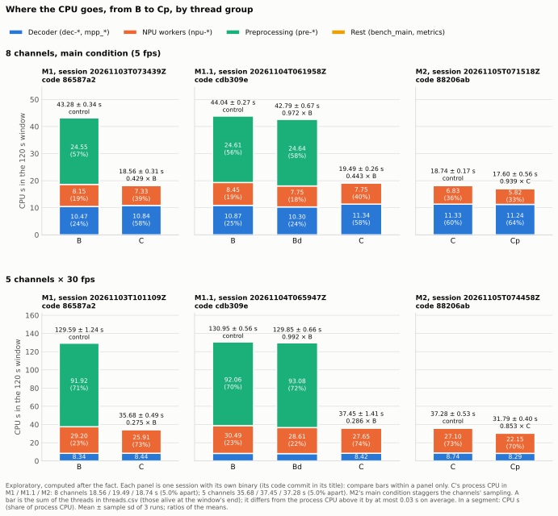

[English](cpu_breakdown.md)

# B에서 Cp까지 CPU는 어디로 가나

**탐색이고, 사후에 계산했다.** 여기 있는 것은 사전 등록하지 않았고, 아무것도 판정하지 않는다. 이 노트는 M1, M1.1, M2에서 커밋된 실행을 다시 읽어, 갈래마다 프로세스 CPU가 어디로 가는지 한곳에 모은다. 영어 문서와 내용이 다르면 [영어 문서](cpu_breakdown.md)가 우선한다.
- **갈래:**
  - **B:** CPU 전처리 뒤에 NPU 입력으로 복사한다(M1);
  - **Bd:** 마지막 복사를 뺀 B(M1.1, A12);
  - **C:** RGA가 NPU 입력에 바로 쓴다. 제로 카피다(M1);
  - **Cp:** NEON 후처리를 쓰는 C(M2).
- **측정점:** 본편 조건(5 fps)의 8채널, 그리고 5채널 × 30 fps.
- **도구:** [tools/cpu_breakdown.py](../../tools/cpu_breakdown.py). 이 노트의 모든 수치는 이 도구에서 나왔다. 전체 출력은 [cpu_breakdown/tables.md](cpu_breakdown/tables.md)에 있다.
- **C10:** YOLOv10n을 쓰는 M4의 갈래는 아직 돌지 않았다. M4를 돌린 뒤에 여기에 더한다.



## 세션과 바이너리

각 단계는 자기 세션의 대조군에 대해 쟀다. 여기의 비율은 세션을 넘어 이어 곱하지 않는다.

| 연구 | 단계 | 스윕(8채널; 5채널) | 코드 |
|---|---|---|---|
| M1 | B → C | [main](../../results/comparison/20261103T073439Z_main), [aux](../../results/comparison/20261103T101109Z_aux) | `86587a2` |
| M1.1 (A12) | B → Bd, B → C | [bdirect_main](../../results/m1.1/20261104T061958Z_bdirect_main), [bdirect_aux](../../results/m1.1/20261104T065947Z_bdirect_aux) | `cdb309e` |
| M2 | C → Cp | [m2_main](../../results/m2/20261105T071518Z_m2_main), [m2_aux](../../results/m2/20261105T074458Z_m2_aux) | `88206ab` |

- **코드:** 각 실행의 `env.json`에 있는 커밋이다. 한 세션의 실행은 모두 같은 커밋이다.
- **실행:** 갈래와 측정점마다 유효한 실행 3회. 값은 120초 측정 창당 평균 ± 표본 표준편차다.
- **세션은 날짜, 세션, 바이너리가 다르다.** M2의 본편 조건은 채널들의 표집에 시차도 둔다([prereg/M2.md](../../prereg/M2.ko.md) §3.1). M1과 M1.1의 본편 조건은 그러지 않는다.
- **세 세션의 C:**
  - 8채널에서 18.56, 19.49, 18.74 s, 5채널 × 30 fps에서 35.68, 37.45, 37.28 s다.
  - 두 측정점 모두 퍼짐이 5.0%다((최대 − 최소) / 최소). 8채널에서는 Cp의 효과와 거의 같은 크기다.
  - 그러니 그림의 패널들은 한 눈금을 쓰지 않는다. 막대는 한 패널 안에서만 비교한다.
- **M1과 M1.1의 B:** 8채널에서 43.28 s와 44.04 s(1.7% 차이), 5채널에서 129.59 s와 130.95 s(1.1%)다.

## 각 단계를 자기 대조군에 대해

프로세스 CPU에서 갈래의 평균을 대조군의 평균으로 나눈 값:

| 단계 | 연구 | 8채널, 본편 | 5채널 × 30 fps |
|---|---|---|---|
| B → C | M1 | 0.429 | 0.275 |
| B → Bd | M1.1 | 0.972 | 0.992 |
| B → C | M1.1 | 0.443 | 0.286 |
| C → Cp | M2 | 0.939 | 0.853 |

- **B → C는 전처리 스레드다.** M1에서 C는 8채널에서 24.72 s를 덜 썼고, 그중 24.26 s가 전처리다. 5채널에서는 93.91 s를 덜 썼고, 그중 90.73 s가 전처리다. M1.1의 B → C도 같게 나뉜다. 24.55 s 중 24.30 s, 93.51 s 중 90.83 s다.
- **B → Bd는 전처리 스레드에 있지 않다.**
  - 8채널에서 Bd는 1.25 s를 덜 썼다. 디코더에서 0.57 s, NPU 워커에서 0.71 s를 덜 썼고, 전처리에서는 0.03 s를 더 썼다.
  - 5채널에서는 1.10 s를 덜 썼다. 디코더에서 0.23 s, NPU 워커에서 1.88 s를 덜 썼고, 전처리에서는 1.01 s를 더 썼다.
  - 이 노트는 그 까닭을 설명하지 않는다.
- **C → Cp는 후처리가 도는 NPU 워커 스레드다.** 8채널에서 덜 쓴 1.14 s 중 1.01 s, 5채널에서 5.49 s 중 4.95 s가 여기서 나왔다.

## 스레드 묶음별 CPU

묶음은 M2 보고서의 것이다([M2.ko.md](../report/M2.ko.md#절감이-어디서-오나탐색)):
- **디코더:** `dec-*`, 그리고 MPP의 `mpp_dec_parser`와 `mpp_dec_hal`;
- **NPU 워커:** `npu-*`;
- **전처리:** `pre-*`;
- **나머지:** `bench_main`과 `metrics`.

8채널, 본편 조건(s):

| 연구 | 갈래 | 프로세스 CPU | 디코더 | NPU 워커 | 전처리 | 나머지 | 디코더 비중 |
|---|---|---|---|---|---|---|---|
| M1 | B | 43.28 ± 0.34 | 10.47 ± 0.18 | 8.15 ± 0.08 | 24.55 ± 0.10 | 0.10 ± 0.01 | 24.2% |
| | C | 18.56 ± 0.31 | 10.84 ± 0.33 | 7.33 ± 0.04 | 0.30 ± 0.01 | 0.11 ± 0.00 | 58.4% |
| M1.1 | B | 44.04 ± 0.27 | 10.87 ± 0.20 | 8.45 ± 0.06 | 24.61 ± 0.01 | 0.10 ± 0.01 | 24.7% |
| | Bd | 42.79 ± 0.67 | 10.30 ± 0.42 | 7.75 ± 0.26 | 24.64 ± 0.06 | 0.10 ± 0.01 | 24.1% |
| | C | 19.49 ± 0.26 | 11.34 ± 0.16 | 7.75 ± 0.12 | 0.31 ± 0.02 | 0.10 ± 0.01 | 58.2% |
| M2 | C | 18.74 ± 0.17 | 11.33 ± 0.15 | 6.83 ± 0.08 | 0.45 ± 0.01 | 0.11 ± 0.00 | 60.5% |
| | Cp | 17.60 ± 0.56 | 11.24 ± 0.53 | 5.82 ± 0.01 | 0.43 ± 0.02 | 0.11 ± 0.01 | 63.8% |

5채널 × 30 fps(s):

| 연구 | 갈래 | 프로세스 CPU | 디코더 | NPU 워커 | 전처리 | 나머지 | 디코더 비중 |
|---|---|---|---|---|---|---|---|
| M1 | B | 129.59 ± 1.24 | 8.34 ± 0.43 | 29.20 ± 0.53 | 91.92 ± 0.33 | 0.12 ± 0.00 | 6.4% |
| | C | 35.68 ± 0.49 | 8.44 ± 0.65 | 25.91 ± 0.15 | 1.18 ± 0.07 | 0.14 ± 0.01 | 23.7% |
| M1.1 | B | 130.95 ± 0.56 | 8.24 ± 0.12 | 30.49 ± 0.17 | 92.06 ± 0.46 | 0.13 ± 0.02 | 6.3% |
| | Bd | 129.85 ± 0.66 | 8.01 ± 0.30 | 28.61 ± 0.52 | 93.08 ± 0.10 | 0.12 ± 0.01 | 6.2% |
| | C | 37.45 ± 1.41 | 8.42 ± 0.72 | 27.65 ± 0.69 | 1.23 ± 0.04 | 0.14 ± 0.01 | 22.5% |
| M2 | C | 37.28 ± 0.53 | 8.74 ± 0.25 | 27.10 ± 0.46 | 1.31 ± 0.02 | 0.14 ± 0.01 | 23.4% |
| | Cp | 31.79 ± 0.40 | 8.29 ± 0.29 | 22.15 ± 0.18 | 1.21 ± 0.04 | 0.14 ± 0.01 | 26.1% |

- **프로세스 CPU와 비교하면:** 네 묶음의 합은 모든 갈래에서, 실행들의 평균으로 프로세스 CPU와 0.03 s 안에서 맞는다. 이 남는 값의 실행 간 표준편차는 많아야 0.07 s다.
  - `threads.csv`에는 측정 창이 끝날 때 살아 있던 스레드가 있다. 그보다 먼저 끝난 스레드가 있었다면 남는 값에 나타난다.

## 입력 경로가 제로 카피가 되면

- **본편 조건의 8채널에서는, 입력 경로가 제로 카피가 되면 디코더 스레드가 가장 큰 묶음이다.**
  - C의 프로세스 CPU 중 M1에서 58.4%, M1.1에서 58.2%, M2에서 60.5%를 썼고, Cp에서는 63.8%를 썼다.
  - B와 Bd에서 가장 큰 묶음은 전처리로, 55.9~57.6%다. 거기서 디코더 스레드는 24.1~24.7%를 썼다.
- **5채널 × 30 fps에서는 그렇지 않다.** 거기서는 C와 Cp 모두 NPU 워커 스레드가 69.7~73.8%로 가장 큰 묶음이다. 디코더 스레드는 22.5~26.1%를 썼다.
- **한 세션 안에서 디코더의 초는 갈래 사이에 거의 바뀌지 않는다.** 8채널에서 B에서 C로 0.38 s(M1)와 0.47 s(M1.1) 늘었고, C에서 Cp로 0.10 s 줄었다. 비중이 커지는 것은 다른 묶음이 줄어서다.

## 발표된 값과 비교

- **도구는 겹치는 발표 값을 발표된 자릿수로 모두 되돌려 준다:**
  - 여기 있는 모든 갈래와 측정점의 프로세스 CPU([M1_tables.md](../report/M1_tables.md), [M2_tables.md](../report/M2_tables.md));
  - M2 보고서의 스레드 묶음 표의 모든 값([M2.ko.md](../report/M2.ko.md#절감이-어디서-오나탐색)).
- **이 비교는 도구의 일부다.** 출력 끝에 비교를 찍고, 맞지 않는 값이 있으면 1로 끝난다.
- **M2 보고서의 표에는 저장소 안에 도구가 없었다.** 이 도구의 묶음은 그 표의 값 12개를 모두 되돌려 준다.

## 다시 만들기

```
python3 tools/cpu_breakdown.py --out docs/notes/cpu_breakdown/tables.md   # cpu_breakdown/cpu_breakdown.svg도
python3 tests/test_cpu_breakdown.py
```

그림에는 날짜나 버전이 들어가지 않는다. 그래서 같은 matplotlib이면 다시 돌려도 같은 바이트를 쓴다.
