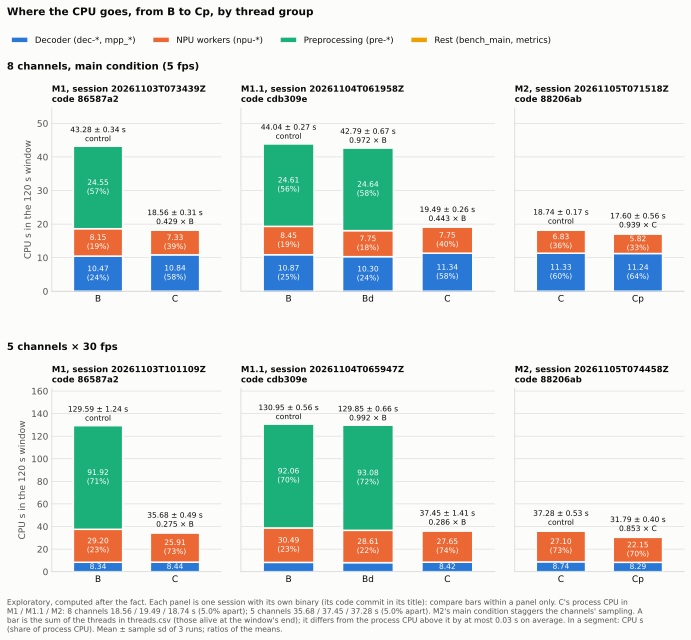

[한국어](cpu_breakdown.ko.md)

# Where the CPU goes, from B to Cp

**Exploratory, computed after the fact.** Nothing here was pre-registered, and nothing is judged. The note reads the committed runs of M1, M1.1 and M2 again, and puts in one place where each arm's process CPU goes.
- **Arms:**
  - **B:** CPU preprocessing, then a copy into the NPU's input (M1);
  - **Bd:** B without its last copy (M1.1, A12);
  - **C:** RGA into the NPU's input, zero copy (M1);
  - **Cp:** C with NEON post-processing (M2).
- **Points:** 8 channels in the main condition (5 fps), and 5 channels × 30 fps.
- **Tool:** [tools/cpu_breakdown.py](../../tools/cpu_breakdown.py). Every number here comes from it. Its full output is [cpu_breakdown/tables.md](cpu_breakdown/tables.md).
- **C10:** M4's arm with YOLOv10n has not run. It is added here once M4 has run.



## Sessions and binaries

Each step is measured against the control of its own session. No ratio here chains across sessions.

| Study | Step | Sweeps (8 ch; 5 ch) | Code |
|---|---|---|---|
| M1 | B → C | [main](../../results/comparison/20261103T073439Z_main), [aux](../../results/comparison/20261103T101109Z_aux) | `86587a2` |
| M1.1 (A12) | B → Bd, B → C | [bdirect_main](../../results/m1.1/20261104T061958Z_bdirect_main), [bdirect_aux](../../results/m1.1/20261104T065947Z_bdirect_aux) | `cdb309e` |
| M2 | C → Cp | [m2_main](../../results/m2/20261105T071518Z_m2_main), [m2_aux](../../results/m2/20261105T074458Z_m2_aux) | `88206ab` |

- **Code:** the commit in each run's `env.json`. Every run of a session has the same one.
- **Runs:** 3 valid runs per arm and point. Values are the mean ± sample sd per 120 s window.
- **The sessions differ** in day, session and binary. M2's main condition also staggers the channels' sampling ([prereg/M2.md](../../prereg/M2.md) §3.1). M1's and M1.1's do not.
- **C in the three sessions:**
  - 18.56, 19.49 and 18.74 s at 8 channels; 35.68, 37.45 and 37.28 s at 5 channels × 30 fps.
  - Both spreads are 5.0% ((max − min) / min). At 8 channels that is about the size of Cp's effect.
  - So the panels of the figure do not share one scale. Compare bars within a panel only.
- **B in M1 and M1.1:** 43.28 and 44.04 s at 8 channels (1.7% apart); 129.59 and 130.95 s at 5 channels (1.1%).

## Each step against its own control

Process CPU, the arm's mean over its control's mean:

| Step | Study | 8 ch, main | 5 ch × 30 fps |
|---|---|---|---|
| B → C | M1 | 0.429 | 0.275 |
| B → Bd | M1.1 | 0.972 | 0.992 |
| B → C | M1.1 | 0.443 | 0.286 |
| C → Cp | M2 | 0.939 | 0.853 |

- **B → C is the preprocessing threads.** In M1, C used 24.72 s less at 8 channels, 24.26 s of it in preprocessing. At 5 channels it used 93.91 s less, 90.73 s of it in preprocessing. M1.1's B → C gives the same split: 24.30 of 24.55 s, and 90.83 of 93.51 s.
- **B → Bd is not in the preprocessing threads.**
  - At 8 channels Bd used 1.25 s less: 0.57 s less in the decoder, 0.71 s less in the NPU workers, and 0.03 s more in preprocessing.
  - At 5 channels it used 1.10 s less: 0.23 s less in the decoder, 1.88 s less in the NPU workers, and 1.01 s more in preprocessing.
  - This note does not explain it.
- **C → Cp is the NPU workers' threads,** where post-processing runs. They used 1.01 of the 1.14 s less at 8 channels, and 4.95 of 5.49 s less at 5 channels.

## CPU by thread group

The groups are the M2 report's ([M2.md](../report/M2.md#where-the-saving-comes-from-exploratory)):
- **Decoder:** `dec-*`, and MPP's `mpp_dec_parser` and `mpp_dec_hal`;
- **NPU workers:** `npu-*`;
- **Preprocessing:** `pre-*`;
- **Rest:** `bench_main` and `metrics`.

8 channels, main condition (s):

| Study | Arm | Process CPU | Decoder | NPU workers | Preprocessing | Rest | Decoder's share |
|---|---|---|---|---|---|---|---|
| M1 | B | 43.28 ± 0.34 | 10.47 ± 0.18 | 8.15 ± 0.08 | 24.55 ± 0.10 | 0.10 ± 0.01 | 24.2% |
| | C | 18.56 ± 0.31 | 10.84 ± 0.33 | 7.33 ± 0.04 | 0.30 ± 0.01 | 0.11 ± 0.00 | 58.4% |
| M1.1 | B | 44.04 ± 0.27 | 10.87 ± 0.20 | 8.45 ± 0.06 | 24.61 ± 0.01 | 0.10 ± 0.01 | 24.7% |
| | Bd | 42.79 ± 0.67 | 10.30 ± 0.42 | 7.75 ± 0.26 | 24.64 ± 0.06 | 0.10 ± 0.01 | 24.1% |
| | C | 19.49 ± 0.26 | 11.34 ± 0.16 | 7.75 ± 0.12 | 0.31 ± 0.02 | 0.10 ± 0.01 | 58.2% |
| M2 | C | 18.74 ± 0.17 | 11.33 ± 0.15 | 6.83 ± 0.08 | 0.45 ± 0.01 | 0.11 ± 0.00 | 60.5% |
| | Cp | 17.60 ± 0.56 | 11.24 ± 0.53 | 5.82 ± 0.01 | 0.43 ± 0.02 | 0.11 ± 0.01 | 63.8% |

5 channels × 30 fps (s):

| Study | Arm | Process CPU | Decoder | NPU workers | Preprocessing | Rest | Decoder's share |
|---|---|---|---|---|---|---|---|
| M1 | B | 129.59 ± 1.24 | 8.34 ± 0.43 | 29.20 ± 0.53 | 91.92 ± 0.33 | 0.12 ± 0.00 | 6.4% |
| | C | 35.68 ± 0.49 | 8.44 ± 0.65 | 25.91 ± 0.15 | 1.18 ± 0.07 | 0.14 ± 0.01 | 23.7% |
| M1.1 | B | 130.95 ± 0.56 | 8.24 ± 0.12 | 30.49 ± 0.17 | 92.06 ± 0.46 | 0.13 ± 0.02 | 6.3% |
| | Bd | 129.85 ± 0.66 | 8.01 ± 0.30 | 28.61 ± 0.52 | 93.08 ± 0.10 | 0.12 ± 0.01 | 6.2% |
| | C | 37.45 ± 1.41 | 8.42 ± 0.72 | 27.65 ± 0.69 | 1.23 ± 0.04 | 0.14 ± 0.01 | 22.5% |
| M2 | C | 37.28 ± 0.53 | 8.74 ± 0.25 | 27.10 ± 0.46 | 1.31 ± 0.02 | 0.14 ± 0.01 | 23.4% |
| | Cp | 31.79 ± 0.40 | 8.29 ± 0.29 | 22.15 ± 0.18 | 1.21 ± 0.04 | 0.14 ± 0.01 | 26.1% |

- **Against process CPU:** the four groups add up to process CPU within 0.03 s for every arm, on average over its runs. This remainder's sd over the runs is at most 0.07 s.
  - `threads.csv` holds the threads alive at the window's end. A thread that ended earlier would show up in the remainder.

## Once the input path is zero copy

- **At 8 channels in the main condition, the decoder's threads are the largest group once the input path is zero copy.**
  - They took 58.4% of C's process CPU in M1, 58.2% in M1.1 and 60.5% in M2, and 63.8% of Cp's.
  - In B and Bd the largest group is preprocessing, with 55.9 to 57.6%. The decoder's threads took 24.1 to 24.7% there.
- **At 5 channels × 30 fps they are not.** There the NPU workers' threads are the largest group in C and Cp, with 69.7 to 73.8%. The decoder's threads took 22.5 to 26.1%.
- **Within a session, the decoder's seconds change little between arms.** At 8 channels they went up 0.38 s (M1) and 0.47 s (M1.1) from B to C, and down 0.10 s from C to Cp. Their share grows because the other groups shrink.

## Against the published values

- **The tool gives back every published value it overlaps with,** at the published digits:
  - the process CPU of every arm and point here ([M1_tables.md](../report/M1_tables.md), [M2_tables.md](../report/M2_tables.md));
  - every value of the M2 report's thread-group table ([M2.md](../report/M2.md#where-the-saving-comes-from-exploratory)).
- **The check is part of the tool.** It prints the comparison at the end of its output, and exits 1 if a value does not match.
- **The M2 report's table had no tool in the repository.** This tool's groups give back each of its 12 values.

## Regenerating

```
python3 tools/cpu_breakdown.py --out docs/notes/cpu_breakdown/tables.md   # and cpu_breakdown/cpu_breakdown.svg
python3 tests/test_cpu_breakdown.py
```

The figure has no date or version in it, so a second run writes the same bytes with the same matplotlib.
