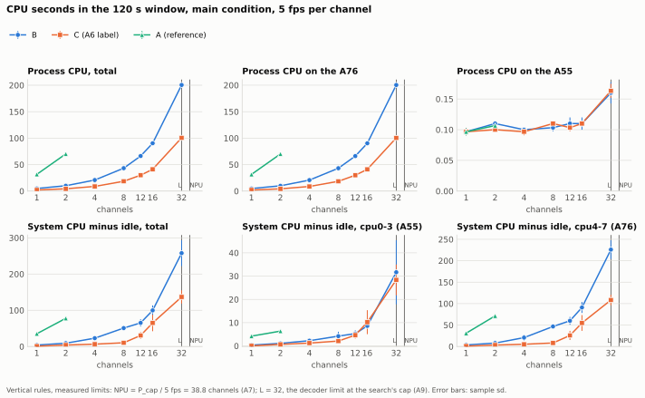
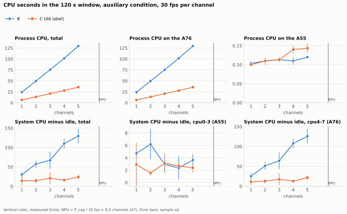
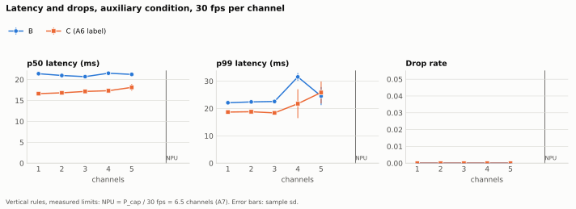
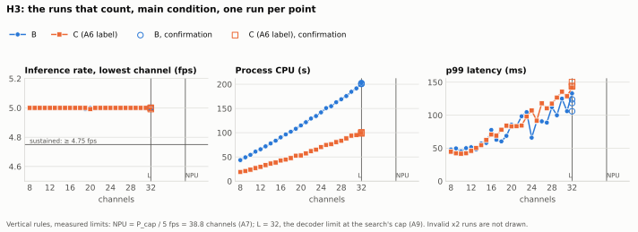
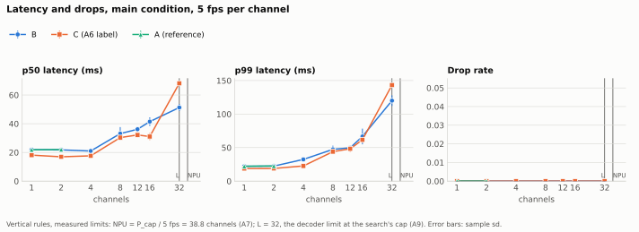
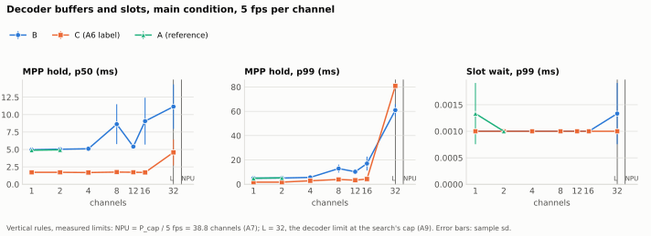
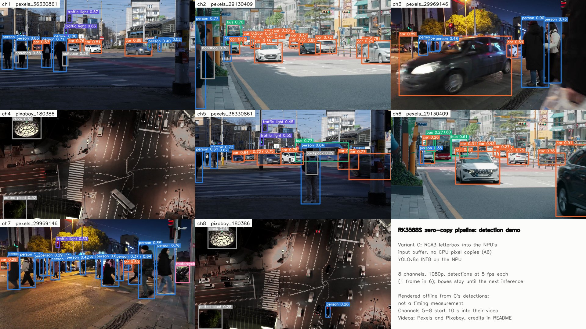

[English](M1.md)

# M1 보고서: RK3588S의 제로카피 입력

영문판과 다르면 영문판을 따른다.

**비교한 것:** NanoPi R6C(RK3588S) 한 대가 하드웨어 디코더로 H.264 스트림을 디코딩하고, NPU에서 YOLOv8n INT8을 돌린다. 변형끼리 다른 것은 디코딩된 프레임에서 NPU 입력까지의 경로뿐이다([HYPOTHESES](../../prereg/HYPOTHESES.ko.md)).

- **B(CPU 복사):** 프레임을 매핑한 뒤, CPU에서 OpenCV로 크기를 바꾸고 색을 변환한다.
- **C(제로카피):** RGA3가 레터박스한 프레임을 NPU 입력 버퍼에 바로 쓴다.
- **A(소프트웨어 디코딩, 참고용):** CPU로 디코딩한 뒤 B의 코드로 전처리한다.

| 가설 | 사양 판정 | 실질 판정 | 수치 |
|---|---|---|---|
| **H1**, 8채널(채널당 5 fps)의 프로세스 CPU | **채택** | **채택** | 120초당 B 43.3초, C 18.6초: 57.1% 적음 |
| **H2**, 5채널(채널당 30 fps)의 p99 지연 | **기각** | **기각** | B 24.5 ms, C 25.9 ms. 둘 다 드롭 없음 |
| **H3**, 채널당 5 fps를 유지하는 최대 채널 수 | **채택** | **판정 불가**(상한 도달) | B 32, C 32: 둘 다 상한 `L` = 32 |

- **요약:** C는 측정한 모든 채널 수에서 CPU 작업을 절반가량 줄인다. 중앙값 지연은 16채널까지 3–10 ms 낮다. NPU가 바쁠 때는 p99가 낮지 않다. 두 변형 모두 상한까지 모든 채널 수를 유지했다.
- **이 결과의 조건:**
  - 파이프라인은 A76 코어 네 개(cpu4–7)에서 돈다.
  - 디코더 버퍼는 CPU 캐시를 쓴다(A1).
- **모든 C 결과에 붙는 표시(A6):** "CPU 픽셀 복사 없는 입력 경로. 추론당 약 1,150건의 작은 복사(약 15 KB)가 NPU 런타임 안에 있어 §11.4 perf 기준은 충족하지 못함. B도 같음"
- **동등성:** B와 C는 A5 기준으로 동등한 텐서와 검출을 낸다. 영상 ①에서도, 홀드아웃 영상 ②, ③, ④에서도 그렇다(A8). 그러니 이 비교는 그 기준 안에서 모델에 같은 입력을 주는 두 경로의 비교다.

## 측정 방법

- **사전 등록:** 가설과 프로토콜을 측정 전에 등록했다.
  - `prereg-v1`은 2026-10-30T02:01:36Z에 만들었다.
  - 프로토콜이 열어 둔 값은 수정 사항 A1–A11에서 정했다.
  - `freeze-m1`이 그 값들을 코드, 소프트웨어, 모델과 함께 2026-11-03T06:58:17Z에 고정했다([env.ko.md](../notes/env.ko.md#등록)).
  - 모든 비교 실행과 참고 실행은 `freeze-m1` 뒤에 시작했다. `tools/check_prereg_order.py`가 각 파일의 머리말로 이를 검사한다.
  - 분석 방법([analysis.ko.md](../notes/analysis.ko.md))과 `tools/m1_report.py`는 첫 비교 세션이 도는 동안 커밋했다. 그때까지 비교 실행의 지표는 하나도 보지 않았다.
- **색:** 두 변형 모두 BT.601 제한 범위로 변환한다. 이는 `prereg-v1`에서 PROTOCOL §8에 등록했다. 크기 조정 방식(A4)은 그 뒤에 정했고, B/C 비교 실행 전에 `freeze-m1`로 고정했다.
- **조건:**
  - *본편:* 채널마다 초당 5회 추론. 30 fps 스트림의 6프레임에 1프레임이다.
  - *보조:* 모든 프레임, 30 fps
  - 스트림은 유선으로 연결된 별도 PC에서 온다. 영상 ①–④를 차례로 배정하고, 1080p H.264를 반복 재생한다([배정](../../stream-server/assignment_m1.txt)).
- **고정 설정:**
  - 클럭: A76 2208 MHz, A55 1800 MHz, DDR 2112 MHz, NPU 1000 MHz. 모든 실행에서 이 값과 대조한다(A7).
  - 냉각: 히트싱크와 항상 켜진 팬(A9)
- **보정(A7, A9):**
  - `P_cap` = 초당 194.2회 추론
  - 디코딩 전용 한계 `L` = 32. 탐색 상한과 같다.
  - 본편 채널 집합: {1, 2, 4, 8, 12, 16, 32}. 보조 집합: {1, 2, 3, 4, 5}
  - 비포화 경계는 0.8 × `P_cap`이다. 5 fps에서 31채널, 30 fps에서 5채널이다. 그래서 5 fps 32채널이 유일한 포화 측정점이다.
- **실행:** 측정점마다 3회 반복한다. 실행마다 20초 워밍업과 120초 측정 창이 있고, 그 앞에 냉각 대기 관문이 있다. 채널 순서는 고정 시드로 섞고, 변형 순서는 번갈아 바꾼다(B→C, C→B, B→C).
- **세션:** 모두 2026-11-03(UTC), 코드 `86587a2`

  | 세션 | 시각(UTC) | 실행 | 실내 온도 |
  |---|---|---|---|
  | [본편](../../results/comparison/20261103T073439Z_main) | 07:44–10:10 | 42 | 27 °C |
  | [보조](../../results/comparison/20261103T101109Z_aux) | 10:21–12:02 | 30 | 26 °C |
  | [H3](../../results/comparison/20261103T120210Z_h3) | 12:12–15:42 | 56 | 26 °C |
  | [A](../../results/reference/20261103T154307Z_reference) | 15:53–16:12 | 6 | 26 °C |

  - **모든 실행이 유효했다.** 무효 ×2 기록, 반복, 잃어버린 시도가 없다. 트립 포인트에 이른 샘플도 없다.
  - **시각:** 첫 실행의 시작부터 마지막 실행의 끝까지
  - **실내 온도:** 운영자가 알려 준 값이고, 측정한 값이 아니다. 본편 세션 전에 27 °C, 나머지 세 세션에는 09:00 UTC에 한 번 알려 준 26 °C다.

## H1: CPU



- **8채널에서:**
  - 프로세스 CPU는 120초 측정 창당 B 43.283 ± 0.343초, C 18.560 ± 0.308초다. (B − C) / B = 57.1%로, 25% 기준을 넘는다.
  - 모든 실행의 모든 채널이 5.000 fps를 유지했으므로, 실질 판정도 같다.
- **혼합 아님:** 유휴분을 뺀 시스템 CPU도 같은 방향이다. B 50.9 ± 7.0초, C 10.3 ± 1.8초
- **본편의 모든 채널 수에서** C는 프로세스 CPU를 50–58% 덜 쓴다. 1채널 56.6%, 4채널 57.7%, 16채널 54.4%, 32채널 49.8%다.
  - 8채널에서 채널 하나에 B는 120초당 CPU 약 5.4초, 코어 하나의 4.5%를 쓰고, C는 약 2.3초, 1.9%를 쓴다. 본편 집합 전체에서 채널당 비용은 B가 5.0–6.3초, C가 2.2–3.1초다.
  - C에 남은 몫의 일부는 디코딩이다. 32채널에서 디코딩만 채널당 약 1.35초가 들었다(`L` 탐색, [calibration.ko.md](../notes/calibration.ko.md#l-결과)).
- **30 fps(보조)에서는** 72–73%를 줄인다. 5채널에서 B 129.6초, C 35.7초다.
- **A**(소프트웨어 디코딩)는 1채널에 31.7초, 2채널에 70.2초가 든다. B의 6–7배다.



## H2: 30 fps의 꼬리 지연



- **5채널, 30 fps에서:**

  | | 반복 1 | 2 | 3 | 평균 |
  |---|---|---|---|---|
  | B, p99 (ms) | 28.3 | 23.2 | 22.1 | 24.5 |
  | C, p99 (ms) | 23.7 | 23.4 | 30.5 | 25.9 |

  - C의 평균이 낮지 않으므로 두 판정 모두 *기각*이다.
  - 실질 규칙은 모든 반복에서 C ≤ 0.9 × B도 요구했다. 이는 반복 1에서만 성립했다.
  - 두 변동계수가 모두 10%를 넘어(B 13.5%, C 15.5%) 표시했다(§9.3).
  - 어느 변형도 프레임을 드롭하지 않았다.
- **중앙값은 C가 낮다:** p50은 B 21.3 ms, C 18.1 ms다. 4채널까지는 C의 p99도 낮다. 3채널에서 18.4 대 22.6 ms, 4채널에서 21.8 대 31.6 ms다.
- **꼬리가 생기는 곳**(탐색 분석, [M1_stages.md](M1_stages.md), 사전 등록 아님):
  - 전처리는 C 1.7 ms, B 5.1 ms다. `rknn_run`은 둘 다 약 15 ms다.
  - 5채널 × 30 fps = 초당 150회 추론, `P_cap`의 77%에서 꼬리는 NPU 워커를 기다리는 시간이다. 그 p99는 B 3.6 ms, C 8.8 ms다. 전처리가 빠르면 프레임이 그 대기열에 더 일찍 도착할 뿐, 대기열이 짧아지지는 않는 것으로 보인다.

## H3: 채널 수



- **탐색:** 두 변형 모두 8채널부터 32채널까지 모든 채널 수를 유지했다. 32채널의 확인 실행 3회도 모두 유지했다. 그래서 `n_B` = `n_C` = 32다.
  - *사양 판정:* `n_C` ≥ `n_B`이므로 채택
  - *실질 판정:* 둘 다 `L` − 1 = 31 이상이므로 판정 불가(상한 도달). 32는 채널 배정의 크기이자 탐색의 상한이다. 그래서 어느 변형도 한계까지 밀어붙이지 않았다.
- **A76 코어 네 개의 예산:** 파이프라인의 모든 스레드는 A76 코어 네 개에서 돈다. H3은 그 예산 안에서 잰 값이다.
  - 32채널에서 B는 120초 측정 창당 프로세스 CPU 200.5초를 썼다. 코어 4개 중 1.67개, 42%다. C는 100.6초, 0.84개, 21%다.
  - 유휴분을 뺀 cpu4–7 시스템 CPU는 B 226초(47%), C 108초(23%)다.
  - 따라서 이 예산 안에서 32채널의 두 변형을 묶은 것은 CPU가 아니라 상한이었다.

## 지연과 디코더



- **16채널까지는** C의 중앙값 지연이 B보다 2.8–10.4 ms 낮고, p99도 낮다. 예를 들어 p99는 1채널에서 18.8 대 22.2 ms, 16채널에서 61.6 대 66.6 ms다.
- **유일한 포화 측정점인 32채널에서는**(초당 160회 추론, 0.8 × `P_cap` 초과) C가 느리다. p50은 68.1 대 51.3 ms, p99는 143.3 대 120.0 ms다.
  - 단계별 시간(탐색 분석)이 시간이 어디서 드는지 보여 준다. 두 변형 모두 대부분 NPU 앞 대기열에서 기다린다. C는 NPU 워커 앞에서 더 오래 기다린다. Q2 p50이 38.9 대 21.8 ms다.
  - `rknn_run` 자체는 둘 다 17 ms다.
  - 포화에서 왜 C의 대기열이 더 긴지는 사전 등록한 지표로는 알 수 없다. 이 보고서는 원인을 주장하지 않는다.
- **MPP 보유 시간**(전처리가 디코더 버퍼를 다 읽을 때까지 그 버퍼를 잡고 있는 시간): 부하가 낮을 때 C는 1.7 ms, B는 5.0 ms 잡고 있다. 32채널에서는 전처리 스레드를 기다리는 시간이 포함되고, C의 p99가 더 높다(80.9 대 61.0 ms).
- **슬롯 대기**는 어디서나 0.001 ms다. 입력 슬롯 11개가 바닥난 적이 없다.
- **어디서나:**
  - 드롭된 프레임도, 잃어버린 디코더 프레임도 없었다.
  - 드리프트는 0.033초(한 프레임) 이하였다.
  - C의 RSS가 0.2–2% 낮았다.
  - 최고 온도는 32채널의 B에서 68.4 °C였다. C는 61.9 °C였다.



## 참고: A

| 채널 | 프로세스 CPU(초) | p99 지연(ms) |
|---|---|---|
| 1 | 31.7(B 5.0, C 2.2) | 22.2(B 22.2, C 18.8) |
| 2 | 70.2(B 10.1, C 4.4) | 22.6(B 22.4, C 18.9) |

이 보드에서 여러 채널을 감당할 수 있게 하는 것은 하드웨어 디코딩이다. 제로카피는 그다음 남은 몫을 절반으로 줄인다.

## 데이터 품질

- **변동계수 10% 초과 표시(§9.3):** p99 지연, 본편 4채널 C(14.0%), 본편 8채널 B(11.7%), 본편 16채널 B(17.6%), 보조 4채널 C(24.3%), 보조 5채널 B(13.5%), 보조 5채널 C(15.5%). 프로세스 CPU는 표시된 적이 없다. 그 변동계수는 5% 미만이다.
- **경고 없음:** 무효 ×2 기록, 세지 않는 시도, 트립 포인트에 이른 샘플이 없다.
- **완료 여부:** `tools/m1_report.py --check`는 "complete"다.

## 타당성 위협

- **보드 하나, 모델 하나, 런타임 하나:**
  - NanoPi R6C 한 대, 640×640 YOLOv8n INT8, librknnrt 2.3.2와 이 보드의 BSP(A10)
  - 다른 보드, 커널, 런타임 버전에서는 다를 수 있다.
- **A76 코어 고정:** 결과는 cpu4–7로 제한한 파이프라인에 대한 것이다. 고정하지 않은 파이프라인은 재지 않았다.
- **커널 스레드:** 프로세스 CPU에는 RGA, NPU, MPP용 같은 커널 자체 스레드와 인터럽트가 빠진다. 유휴분을 뺀 시스템 CPU가 이를 포함하고, 프로세스 CPU와 방향이 같다(H1은 혼합 아님).
- **완전한 제로카피는 아님(A6):**
  - C에도 NPU 런타임 안에서 추론당 약 1,150건의 작은 복사(약 15 KB)가 남아 있다. B도 같다.
  - 두 변형 모두 NCHW INT8 출력을 바인딩하는데, 런타임이 이를 CPU에서 변환하는 것으로 보인다. 추론당 약 1.2 MB다.
- **색 행렬:** 두 변형 모두 BT.601로 변환한다. 영상 ①과 ③은 BT.709로 표시돼 있고, ②와 ④는 표시가 없다. 오차가 있다면 B와 C에 같다.
- **열:** 클럭은 고정하고 모든 실행에서 확인했으며, 트립 포인트에 이른 샘플은 없다. 실내 온도(26–27 °C)는 운영자가 알려 준 값이고(마지막 세 세션은 한 번), 측정한 값이 아니다.
- **입력:** 송출 PC 한 대에서 오는 거리 영상 네 개를 반복 재생했다. 영상 내용에 따라 후처리 시간과 검출 수가 달라진다.
- **A5의 상대 기준에 따른 동등성:** B와 C는 처음 등록한 절대 기준이 아니라, B 자신의 허용 변형과 비교해 판단했다(A5).
- **H3의 상한:** `L` = 32는 탐색 상한이자 채널 배정의 크기다. 32채널 너머의 용량은 알 수 없다.

## M1 이후: 4K 입력(M1.1, 탐색용)

- **설계(A11):** B와 C를 1·2·4·8채널, 본편 조건으로 3회씩 반복했다. 영상 ①, ②, ④를 3840×2160, 16 Mbps로 다시 인코딩했다. 가설을 검정하지 않고, 아무것도 판정하지 않는다.
- **실행:** M1의 모든 세션을 마친 뒤 2026-11-04에 24회를 실행했고, 모두 유효했다([결과](../../results/m1.1/20261104T005719Z_4k)). 모든 수치는 [M1_tables.md](M1_tables.md#m11-4k-input-exploratory-a11)에 있다.
- **관찰, 판정 아님:**
  - 모든 채널 수에서 C의 프로세스 CPU가 B보다 59–60% 적었다. 8채널에서 120초당 B 96.2초, C 39.5초로, 각각 1080p 값의 약 두 배다.
  - 모든 채널 수에서 C의 p99 지연이 낮았다. 8채널에서 25.3 ms 대 32.4 ms다.
  - 모든 실행이 채널마다 5 fps를 유지했고, 버린 프레임이 없었다.
  - **서버 경고:** 8채널에서는 B와 C의 모든 실행에서 송출 서버가 "reader is too slow, discarding … frames"를 기록했다. 이 줄은 실행 시작 2–5초 뒤 예열 중에 나왔고, 측정 구간에는 나오지 않았다. A11의 디코딩 전용 검사도 8채널에서 같은 것을 보았다. 세션은 이를 경고로 기록한다([runs.tsv](../../results/m1.1/20261104T005719Z_4k/runs.tsv)).
  - **텐서:** ① 4K의 1,000프레임에서 C의 텐서는 R의 텐서보다 B에서 더 멀다. MAE는 4.52 대 1.88, 최소 PSNR은 28.6 대 37.3 dB다. 전체 박스 수는 B보다 C가 +1.46%, R이 +0.04% 다르다([recheck.txt](../../results/m1.1/20261104T023058Z_4k_tensors/recheck.txt)).
  - A11에 따라, 4K에서는 A5의 동등성을 주장하지 않는다.
- **정리:** M1.1과 함께 나온다.

## 데모



- **보여 주는 것:** `v0.1-m1`의 데모 영상은 8채널에서 채널마다 5 fps로 C가 검출한 결과를 보여 준다([demo.ko.md](../notes/demo.ko.md)).
  - 그 검출 결과로 오프라인 렌더한 것이라, 시간에 대해서는 아무것도 말하지 않는다. 시간은 위의 실행이 잰다.
  - 영상은 `v0.1-m1` Release에 첨부한다.
- **영상 원본:** 영상과 이 프레임 속 원본 영상은 각자의 라이선스, Pexels License와 Pixabay Content License를 따른다. 저장소의 Apache-2.0은 여기에 적용되지 않는다.
  - 영상 제작자는 SHOX ART, Paul Bill, Sururi Ballıdağ(Pexels)와 Kanenori(Pixabay)다.

## 이 보고서 재현하기

저장소를 클론한 곳에서, Python 3, numpy, matplotlib으로:

```sh
python3 tools/m1_report.py --check                     # "complete"
python3 tools/m1_report.py --out docs/report/M1_tables.md --json docs/report/M1_summary.json
python3 tools/m1_plots.py                              # docs/report/figures/*.svg
python3 tools/m1_stages.py --out docs/report/M1_stages.md
python3 tools/check_prereg_order.py                    # 문제 0건
git diff --exit-code docs/report                       # 같은 파일
```

| 파일 | 내용 |
|---|---|
| [M1_tables.md](M1_tables.md) | 모든 측정점과 지표의 평균 ± 표준편차(n), 그리고 목록. 마지막에 M1.1의 4K 절 |
| [M1_summary.json](M1_summary.json) | 같은 수치를 소수 3자리로 |
| [demo/](demo/) | 데모의 검출 결과, 로그, 정지 화면, 영상의 SHA-256 |
| [M1_stages.md](M1_stages.md) | 단계별 시간, 탐색 분석 |
| [figures/](figures/) | 위의 그림 |
| [results/](../../results/) | 모든 실행의 원시 파일 |

분석 방법은 [analysis.ko.md](../notes/analysis.ko.md)에, 스윕 절차는 [comparison.ko.md](../notes/comparison.ko.md)에 있다.
