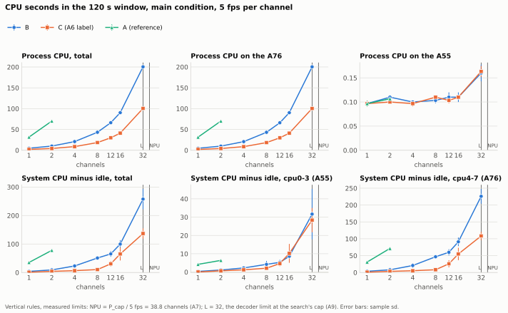
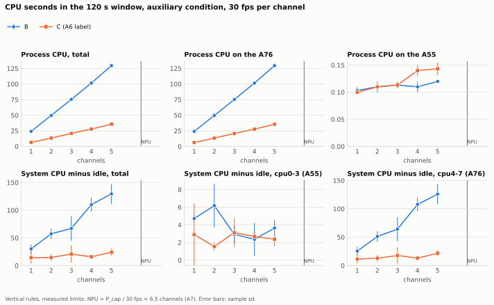
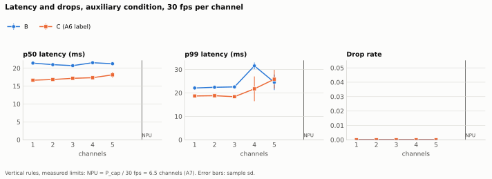
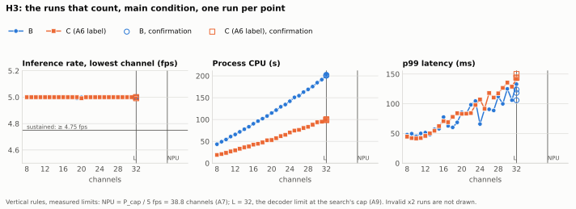
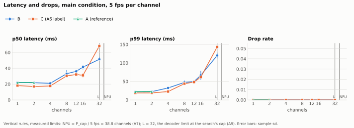
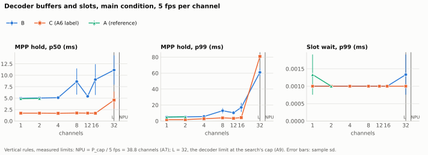
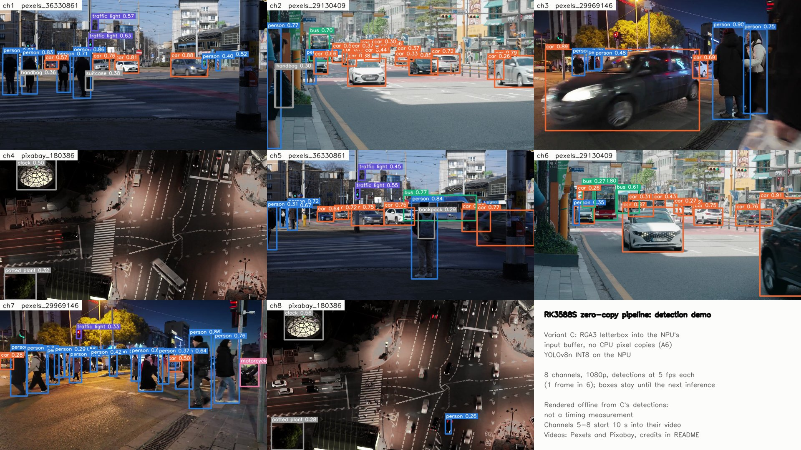

[한국어](M1.ko.md)

# M1 report: zero-copy input on the RK3588S

**What was compared:** one NanoPi R6C (RK3588S) decodes H.264 streams with the hardware decoder and runs YOLOv8n INT8 on the NPU. Only the path from the decoded frame to the NPU input differs between the variants ([HYPOTHESES](../../prereg/HYPOTHESES.md)):

- **B (CPU copy):** maps the frame, then resizes and converts it with OpenCV on the CPU.
- **C (zero copy):** RGA3 writes the letterboxed frame straight into the NPU's input buffer.
- **A (software decode, reference only):** decodes on the CPU, then preprocesses with B's code.

| Hypothesis | Spec-literal | Practical | Numbers |
|---|---|---|---|
| **H1**, process CPU at 8 channels, 5 fps each | **adopted** | **adopted** | B 43.3 s, C 18.6 s per 120 s: 57.1% less |
| **H2**, p99 latency at 5 channels, 30 fps each | **rejected** | **rejected** | B 24.5 ms, C 25.9 ms; no drops in either |
| **H3**, most channels at 5 fps each | **adopted** | **indeterminate** (ceiling reached) | B 32, C 32: both at the cap `L` = 32 |

- **In short:** C about halves the CPU work at every channel count measured. Its median latency is lower up to 16 channels, by 3 to 10 ms. Its p99 is not lower when the NPU is busy. Both variants sustained every channel count up to the cap.
- **These results hold under these conditions:**
  - the pipeline runs on the four A76 cores (cpu4–7);
  - the decoder's buffers are CPU-cached (A1).
- **Label on every C result (A6):** "input path without CPU pixel copies; §11.4 perf criterion not met because of about 1,150 small copies (about 15 KB) per inference inside the NPU runtime, as in B".
- **Equivalence:** B and C give equivalent tensors and detections under A5's criteria, on video ① and on the held-out videos ②, ③ and ④ (A8). So the comparison is between two paths that feed the model the same input, within those criteria.

## How it was measured

- **Pre-registration:** hypotheses and protocol were registered before any measurement.
  - `prereg-v1` was created at 2026-10-30T02:01:36Z.
  - The values the protocol left open were fixed in amendments A1 to A11.
  - `freeze-m1` froze them, with the code, software and model, at 2026-11-03T06:58:17Z ([env.md](../notes/env.md#registration)).
  - Every comparison and reference run started after `freeze-m1`. `tools/check_prereg_order.py` checks this from each file's own header.
  - The analysis method ([analysis.md](../notes/analysis.md)) and `tools/m1_report.py` were committed while the first comparison session ran. By then no metric of any comparison run had been looked at.
- **Colour:** both variants convert BT.601 limited range. This was registered in PROTOCOL §8 at `prereg-v1`. The scaling choices (A4) came later, and were fixed at `freeze-m1`, before any B/C comparison run.
- **Conditions:**
  - *Main:* 5 inferences per second per channel, 1 frame in 6 of a 30 fps stream.
  - *Auxiliary:* every frame, 30 fps.
  - Streams come from a separate PC over a wired link: videos ① to ④ in turn, 1080p H.264, looped ([assignment](../../stream-server/assignment_m1.txt)).
- **Fixed settings:**
  - Clocks: A76 at 2208 MHz, A55 at 1800 MHz, DDR at 2112 MHz, NPU at 1000 MHz. Every run is checked against them (A7).
  - Cooling: a heatsink with an always-on fan (A9).
- **Calibration (A7, A9):**
  - `P_cap` = 194.2 inferences/s.
  - The decode-only limit `L` = 32, which is the search's cap.
  - Main channel set: {1, 2, 4, 8, 12, 16, 32}; auxiliary set: {1, 2, 3, 4, 5}.
  - The unsaturated boundary is 0.8 × `P_cap`: 31 channels at 5 fps, 5 at 30 fps. So 32 channels at 5 fps is the one saturated point.
- **Runs:** 3 repetitions per point. Each run has a 20 s warm-up and a 120 s window, preceded by a cooldown gate. Channel order is shuffled with a fixed seed, and the variant order alternates (B→C, C→B, B→C).
- **Sessions,** all on 2026-11-03 (UTC) with code `86587a2`:

  | Session | Time (UTC) | Runs | Ambient |
  |---|---|---|---|
  | [main](../../results/comparison/20261103T073439Z_main) | 07:44–10:10 | 42 | 27 °C |
  | [auxiliary](../../results/comparison/20261103T101109Z_aux) | 10:21–12:02 | 30 | 26 °C |
  | [H3](../../results/comparison/20261103T120210Z_h3) | 12:12–15:42 | 56 | 26 °C |
  | [A](../../results/reference/20261103T154307Z_reference) | 15:53–16:12 | 6 | 26 °C |

  - **Every run was valid.** There are no invalid ×2 records, no repeats and no lost attempts. No sample reached a trip point.
  - **Times:** from the first run's start to the last run's end.
  - **Ambient:** reported by the operator, not measured: 27 °C before the main session, and 26 °C once, at 09:00 UTC, for the other three.

## H1: CPU



- **At 8 channels:**
  - process CPU: B 43.283 ± 0.343 s, C 18.560 ± 0.308 s per 120 s window. (B − C) / B = 57.1%, above the 25% threshold.
  - every channel of every run held 5.000 fps, so the practical verdict is the same.
- **Not mixed:** system CPU minus idle points the same way: B 50.9 ± 7.0 s, C 10.3 ± 1.8 s.
- **At every main count,** C uses 50 to 58% less process CPU: 56.6% at 1 channel, 57.7% at 4, 54.4% at 16 and 49.8% at 32.
  - Per channel at 8 channels, B costs about 5.4 s of CPU per 120 s, 4.5% of a core, and C about 2.3 s, 1.9%. Across the main set, B's cost per channel ranges from 5.0 to 6.3 s, C's from 2.2 to 3.1 s.
  - Part of what remains for C is decoding. Decoding alone took about 1.35 s per channel at 32 channels (`L` search, [calibration.md](../notes/calibration.md#l-results)).
- **At 30 fps (auxiliary),** the saving is 72 to 73%: B 129.6 s, C 35.7 s at 5 channels.
- **A** (software decode) needs 31.7 s at 1 channel and 70.2 s at 2: 6 to 7 times B.



## H2: tail latency at 30 fps



- **At 5 channels, 30 fps:**

  | | Repetition 1 | 2 | 3 | Mean |
  |---|---|---|---|---|
  | B, p99 (ms) | 28.3 | 23.2 | 22.1 | 24.5 |
  | C, p99 (ms) | 23.7 | 23.4 | 30.5 | 25.9 |

  - C's mean is not lower, so both verdicts are *rejected*.
  - The practical rule also wanted C ≤ 0.9 × B in every repetition. That held only in repetition 1.
  - Both coefficients of variation are above 10% (B 13.5%, C 15.5%); this is flagged (§9.3).
  - No frame was dropped by either variant.
- **The median is lower with C:** p50 B 21.3 ms, C 18.1 ms. Up to 4 channels, C's p99 is lower too: 18.4 against 22.6 ms at 3 channels, 21.8 against 31.6 ms at 4.
- **Where the tail comes from** (exploratory, [M1_stages.md](M1_stages.md), not pre-registered):
  - C's preprocessing takes 1.7 ms, B's 5.1 ms. `rknn_run` takes about 15 ms in both.
  - At 5 channels × 30 fps = 150 inferences/s, 77% of `P_cap`, the tail is the wait for an NPU worker. Its p99 is 3.6 ms for B and 8.8 ms for C. This suggests that a faster preprocessing step brings frames to that queue sooner, without shortening it.

## H3: channels



- **The search:** both variants sustained every count from 8 to 32 channels. All 3 confirmation runs at 32 sustained too. So `n_B` = `n_C` = 32.
  - *Spec-literal:* `n_C` ≥ `n_B`, adopted.
  - *Practical:* both are at least `L` − 1 = 31, so the result is indeterminate (ceiling reached). 32 is the size of the channel assignment and the cap of the search, so neither variant was pushed to its limit.
- **The A76 four-core budget:** every pipeline thread runs on the four A76 cores, and that is the budget H3 measures within.
  - At 32 channels, B used 200.5 s of process CPU per 120 s window: 1.67 of the 4 cores, 42%. C used 100.6 s: 0.84 cores, 21%.
  - System CPU on cpu4–7, minus idle, was B 226 s (47%) and C 108 s (23%).
  - So within this budget, CPU did not bound either variant at 32 channels. The cap did.

## Latency and the decoder



- **Up to 16 channels,** C's median latency is 2.8 to 10.4 ms lower than B's, and its p99 is lower too. For example, p99 is 18.8 against 22.2 ms at 1 channel and 61.6 against 66.6 ms at 16.
- **At 32 channels,** the one saturated point (160 inferences/s, above 0.8 × `P_cap`), C is slower: p50 68.1 against 51.3 ms, p99 143.3 against 120.0 ms.
  - The stage times (exploratory) show where the time goes. Both variants wait mostly in the queues before the NPU. C waits longer before an NPU worker: Q2 p50 38.9 against 21.8 ms.
  - `rknn_run` itself takes 17 ms in both.
  - The pre-registered metrics do not say why C's queue is longer at saturation. This report does not claim a cause.
- **MPP hold time** (decoder buffer held until preprocessing has read it): at low load, C holds the buffer 1.7 ms, B 5.0 ms. At 32 channels it includes the wait for a preprocessing thread, and C's p99 is higher (80.9 against 61.0 ms).
- **Slot wait** stays at 0.001 ms everywhere: the 11 input slots never ran out.
- **Everywhere:**
  - no frame was dropped and no decoder frame was lost;
  - drift stayed at or below 0.033 s, one frame;
  - C's RSS was 0.2 to 2% lower;
  - the highest temperature was 68.4 °C, for B at 32 channels, against 61.9 °C for C.



## Reference: A

| Channels | Process CPU (s) | p99 latency (ms) |
|---|---|---|
| 1 | 31.7 (B 5.0, C 2.2) | 22.2 (B 22.2, C 18.8) |
| 2 | 70.2 (B 10.1, C 4.4) | 22.6 (B 22.4, C 18.9) |

Hardware decoding is what makes multi-channel work affordable on this board. Zero copy then halves what is left.

## Data quality

- **Flagged, CV above 10% (§9.3):** p99 latency at main 4 ch C (14.0%), main 8 ch B (11.7%), main 16 ch B (17.6%), aux 4 ch C (24.3%), aux 5 ch B (13.5%) and aux 5 ch C (15.5%). Process CPU is never flagged; its CV stays below 5%.
- **No warnings:** no invalid ×2 records, no attempts that do not count, no samples at a trip point.
- **Completeness:** `tools/m1_report.py --check` gives "complete".

## Threats to validity

- **One board, one model, one runtime:**
  - one NanoPi R6C, YOLOv8n INT8 at 640×640, librknnrt 2.3.2 and the board's BSP (A10);
  - other boards, kernels or runtime versions may differ.
- **Pinned to the A76 cores:** the results hold for a pipeline restricted to cpu4–7. An unpinned pipeline was not measured.
- **Kernel threads:** process CPU leaves out the kernel's own threads and interrupts, such as those for RGA, the NPU and MPP. System CPU minus idle covers them, and it agrees with process CPU (H1 is not mixed).
- **Not fully zero copy (A6):**
  - C still makes about 1,150 small copies (about 15 KB) per inference inside the NPU runtime, as B does.
  - Both variants bind NCHW INT8 outputs, which the runtime appears to convert on the CPU, about 1.2 MB per inference.
- **Colour matrix:** both variants convert with BT.601. Videos ① and ③ are tagged BT.709, and ② and ④ are untagged. Any error is the same for B and C.
- **Thermal:** the clocks were fixed and checked in every run, and no sample reached a trip point. The ambient temperature (26 to 27 °C) was reported by the operator, once for the last three sessions, and not measured.
- **Inputs:** four looped street videos from one stream PC. The content changes post-processing time and the number of detections.
- **Equivalence by A5's relative criteria:** B and C were compared against B's own admissible variants (A5), not against the absolute thresholds first registered.
- **H3's ceiling:** `L` = 32 is the cap of the search and the size of the channel assignment. Capacity above 32 channels is unknown.

## After M1: 4K input (M1.1, exploratory)

- **The design (A11):** B and C at 1, 2, 4 and 8 channels, main condition, 3 repetitions. Videos ①, ② and ④ are re-encoded at 3840×2160 and 16 Mbps. No hypothesis is tested, and nothing is judged.
- **Runs:** 24, on 2026-11-04 after every M1 session, all valid ([results](../../results/m1.1/20261104T005719Z_4k)). Every number is in [M1_tables.md](M1_tables.md#m11-4k-input-exploratory-a11).
- **Seen, not judged:**
  - C used 59 to 60% less process CPU than B at every count. At 8 channels: B 96.2 s, C 39.5 s per 120 s, about twice their 1080p values.
  - C's p99 latency was lower at every count: 25.3 against 32.4 ms at 8 channels.
  - Every run held 5 fps per channel, with no drops.
  - **Tensors:** on 1,000 frames of ① at 4K, C's tensors are further from B's than R's are: MAE 4.52 against 1.88 ([recheck.txt](../../results/m1.1/20261104T023058Z_4k_tensors/recheck.txt)). So equivalence under A5 is not claimed at 4K.
- **Write-up:** comes with M1.1.

## Demo



- **What it shows:** the demo video of `v0.1-m1` shows C's detections on eight channels at 5 fps each ([demo.md](../notes/demo.md)).
  - It is rendered offline from those detections, so it says nothing about timing. The runs above measure timing.
  - The video is attached to the `v0.1-m1` Release.
- **Footage:** the footage in the video and in this frame stays under the videos' own licenses, the Pexels License and the Pixabay Content License. The repository's Apache-2.0 does not cover it.
  - The videos are by SHOX ART, Paul Bill and Sururi Ballıdağ (Pexels) and Kanenori (Pixabay).

## Reproducing this report

From a clone of the repository, with Python 3, numpy and matplotlib:

```sh
python3 tools/m1_report.py --check                     # "complete"
python3 tools/m1_report.py --out docs/report/M1_tables.md --json docs/report/M1_summary.json
python3 tools/m1_plots.py                              # docs/report/figures/*.svg
python3 tools/m1_stages.py --out docs/report/M1_stages.md
python3 tools/check_prereg_order.py                    # 0 problems
git diff --exit-code docs/report                       # the same files
```

| File | What |
|---|---|
| [M1_tables.md](M1_tables.md) | every point and metric, mean ± sd (n), and the lists, with M1.1's 4K section last |
| [M1_summary.json](M1_summary.json) | the same numbers, rounded to 3 decimals |
| [demo/](demo/) | the demo's detections, logs, still frame and the video's SHA-256 |
| [M1_stages.md](M1_stages.md) | stage times, exploratory |
| [figures/](figures/) | the figures above |
| [results/](../../results/) | every run's raw files |

The analysis method is in [analysis.md](../notes/analysis.md), and the sweep procedure in [comparison.md](../notes/comparison.md).
